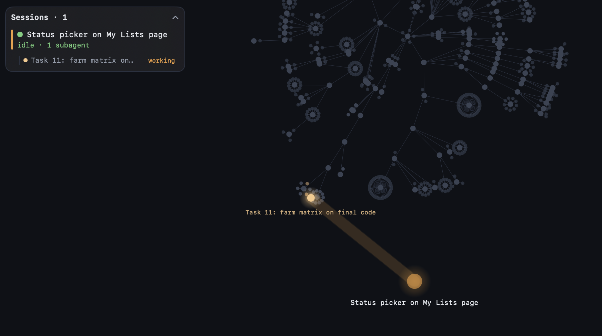

# SessionVis

A native macOS visualiser for live Claude Code sessions. Point it at one or more directories, one per tab, and it tails the Claude Code transcripts for each (and every git worktree of it, wherever it is checked out), draws the repo as a gource-style radial graph, and shows each session as an orb that fires beams at the files it reads and edits. Subagents are smaller orbs inside their parent's halo, each in its own shade of the parent's colour. A touched file flashes in the session's colour, then keeps a tint of it that fades back to grey over two minutes, so you can see where each agent has recently been. A floating list mirrors iTerm's Session Status panel.

## Run

    swift run SessionVis --dir /path/to/repo            # live
    swift run SessionVis --replay <transcript.jsonl> --speed 20 --dir /path/to/repo
    scripts/bundle-app.sh && open dist/SessionVis.app --args --dir /path/to/repo
    swift run SessionVis                                # reopens the tabs from last time

The directory must be passed with `--dir` (a relative path is resolved against the current directory, and spellings of one directory through symlinks, `/tmp` or a different case are one tab); a bare path argument is treated by AppKit as a document to open and no window appears. `--dir` selects the tab for that directory or adds one; without arguments the tabs from the last run come back. A replay opens in its own tab and is not remembered.

Trackpad scroll pans, pinch zooms, double-click refits. Click a session in the list or its orb to follow it; Tab and Shift-Tab step the follow through the live sessions, Escape stops it where the view is (the Session menu has the same three actions as ⌘], ⌘[ and ⌘.). ⌘T opens a directory in a new tab, ⌘W closes the tab (⌘⇧W closes the window, and ⌘W closes Settings when it is the key window), ⌘⇧] and ⌘⇧[ switch tabs, ⌘1–⌘9 jump to one, ⌥⌘← and ⌥⌘→ move it, ⌘O replaces the current tab's directory. ⌘⇧F toggles focus mode, ⌘L collapses the list, ⌘, shows settings: the optional hook snippet for exact "waiting on permission" states, and hidden-file rules for the selected tab.

## Privacy

- To find which sessions belong to the directory, SessionVis reads the head of every transcript under `~/.claude/projects` (up to 256 KB each, only for transcripts modified in the last 30 minutes) and then tails the member transcripts.
- The session list shows prompt text (session titles fall back to the first prompt; waiting rows preview the question).
- The optional hook writes raw hook payloads (prompts, tool inputs and outputs) to `~/Library/Application Support/SessionVis/hooks` only while SessionVis is running (it checks a marker file the app creates when its first live tab opens, so a replay-only launch creates none, and removes on quit). One reader for the whole app deletes each file as it reads it and hands the payload to every tab whose directory it belongs to; leftovers older than an hour are pruned.
- Nothing leaves your machine.

## Status

What you can check by hand:

- Two-finger pan, pinch zoom, double-click to refit the view.
- Hover tooltips on files and orbs.
- Files recently touched are tinted in the toucher's colour and fade back to grey over two minutes; the tooltip names the last toucher for the same window and shows a swatch of its colour. A subagent's colour is a shade of its session's (paler, darker, pastel or deep, by the order the subagent transcripts were created, which can shift live if the folder changes but always matches a relaunch; a nested subagent never repeats its parent's), so the trail says which subagent was there while the halo says which session.
- The edges from the root down to a touched file light up in the same colour, slightly thicker, and fade on the same schedule, so each session leaves a visible trail through the tree; an edge shared by several touched files takes the colour of the most recent toucher.
- Every git worktree of the repository is folded onto the tree, wherever it is checked out (`.claude/worktrees`, a `.worktrees` folder inside the root, or a sibling directory), and is picked up as soon as git registers it. Files that exist only in a worktree draw as hollow rings on dashed edges, seeded from disk at launch. A ring fills into a dot when the file lands in the main checkout, and dies red when its worktree is removed. The tooltip names the worktree.
- Every Bash call pulses the calling orb with a short label. A git commit ripples along the edges that session has lit, drops its files' tint to a faint floor and pins the short hash above the orb; a push lifts the badge off. The session list shows the running command and the latest git milestone.
- Reads and writes done through shell commands count as touches: operands of `cat`, `head`, `tail`, `sed`, `awk`, `grep`, `rg`, `ls`, `find`, `diff`, `cp`, `mv`, `tee`, `touch` and redirections, resolved against the command's `cd` and the session's directory; a read counts only if the file or directory exists. A search or listing lights the directory it ran in. A file that changes on disk while exactly one agent is running a command is credited to that agent as a write. The tooltip names the source of each touch.
- Settings has a Hidden files section: gitignore-like glob patterns (no negation or comments) (`*.graphql.swift`, `Generated`, `Sources/**/Mocks`) hide matching files from the graph, with one-click suggestions from the most common file suffixes. Rules are kept per directory, apply the moment they are toggled without a rescan, and a session's touch on a hidden file is still counted in the tooltip but drawn nowhere.
- A subagent fades out within a few seconds of finishing, whether it ran in the foreground or in the background (its final hand-back call and the parent's task notification both count as the end).
- Following a session zooms the camera to frame its orb, its subagents and the files it touched in the last 20 seconds, within a fixed zoom range, and rings the orb; the list row shows a scope glyph. Tab and Shift-Tab cycle the follow through live sessions, Escape stops it without moving the view, a pan or pinch stops it too.
- Each orb wears a thin arc that fills clockwise as the session's context fills (amber from 80%, red from 92%), and the session list shows `142k / 1M · 14%`; a compaction drops the arc at once. The orb's tooltip adds the lifetime input and output token counts and the model.
- Focus mode (View › Focus Mode, ⌘⇧F, remembered across launches) keeps every file on screen but gives the room to the active ones: a directory's sector grows with the files touched in the last 30 minutes (or still tinted), idle files bunch tightly on their ring and draw small and faint, and the layout follows activity every few seconds with the usual gliding transition.
- Tabs: each watches one directory with its own graph, sessions, camera and hidden-file rules, shows a hue dot and a badge with the number of working sessions and, pulsing, the number waiting on you; hidden tabs keep tracking so the badge is current, and switching to one picks up with its tints intact rather than replaying every beam since. The tab set is restored on launch; `--replay` without `--dir` restores the saved tabs and shows a short message; a directory that is missing keeps its tab with a warning until it comes back or you re-point it.
- ⌘L collapses and expands the session list.
- ⌘, opens settings with the hook snippet, hidden-file rules and a "Worktrees" row listing each registered worktree as `name · path`.
- Double-click a session row (or click the terminal button that appears when hovering it, or press ⌘⇧T with the row selected) to bring the iTerm2 or Terminal tab running that session to the front; a subagent row opens its parent's. If none is found, the list says so for a few seconds.

## Known gaps

- File changes on disk (including deletions and moves) are picked up by an FSEvents watcher within about half a second; deletions fade out red, moves glide. Changes made while several agents run commands at once, or while none does, stay unattributed. Script bodies (`python3 - <<EOF`, `swift run`) are not parsed; their writes arrive through disk attribution only, and their reads are invisible. Globs and variables in shell operands are never expanded, and after a `cd` to `~` or a variable the relative operands of that command are skipped.
- Phantom-file reconciliation (files an agent touched that do not exist) relies on a filesystem existence check under the main checkout and each registered worktree, so gitignored files an agent really wrote stay visible.
- Command classification scans the `&&`-, `;`- and newline-chained segments of a shell command, and each git commit, push, merge or rebase in the chain counts as its own milestone, in order (so `git commit … && git push` commits and then lifts the badge). An unusual wrapper (an alias, a script that commits) will not register.
- Worktrees are discovered through `git worktree list`; a directory under `.claude/worktrees` that git does not list is ignored, and when git cannot be run those directories are taken as the worktrees instead. A worktree deleted without `git worktree remove` or `prune` stays listed until the next registry change (its files still fade, since its listing comes back empty).
- Context windows come from a small table keyed by model-id prefix. An unlisted model shows token counts but no ring, and a model whose real window is larger than the table says is shown against the next larger tier once its context exceeds the smaller one. Totals count cache reads as input.
- Directory renames animate as per-file moves.
- `.git` churn triggers rescans (cheap).
- Opening a session's terminal needs Automation access to iTerm2 or Terminal (macOS asks on first use) and finds only sessions on a tty one of those apps owns: tmux panes, ssh and remote sessions and other terminal apps report "No terminal window found".
- Hover is not refreshed while panning under a still cursor.
- Two tabs on overlapping checkouts (a repository and one of its worktrees opened as its own tab) both show the sessions and hook events that match them; a session started in a subdirectory of a checkout belongs to no tab.
- A hidden tab's file watcher costs as much as a visible one on a busy repository. Launching the app again with `--dir` while it is running starts a second process rather than adding a tab.

## Develop

    swift test
